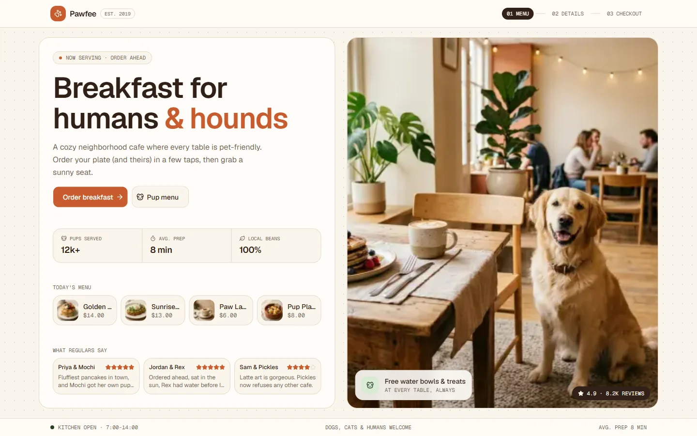

# Pawfee: Pet-Friendly Breakfast Cafe

An online ordering site for a made-up, pet-friendly breakfast cafe. You choose a plate, pick a size, add a side for your dog, check out, and then watch your order move through the kitchen.

**Live demo:** [pet-breakfast-cafe.vercel.app](https://pet-breakfast-cafe.vercel.app)



> This is a demo concept, not a real business. The menu, ratings, reviews and stats are made up, and the checkout never charges or stores a card. You can use the test number `4242 4242 4242 4242`.

## Features

- **Menu and product pages.** There are four plates, each with tags, a rating and a description. The Pup Plate is a dog-safe meal.
- **Order customisation.** Choose Regular, Large or Share size, set the quantity, and add a pup side. The total updates as you change things.
- **Checkout.** The card form formats the number and expiry date as you type and validates each field. You also choose dine-in or pickup, and the order summary shows tax.
- **Order tracking.** After you pay, animal staff take your order through three animated stages, and a sound made with the Web Audio API plays when it's ready.
- **Step indicator.** The header shows where you are in the Menu → Details → Checkout flow.
- **Fits the screen.** The layout fills one screen on a laptop and stacks on a phone.

## Tech stack

- [Next.js 16](https://nextjs.org/) (App Router) with React 19 and TypeScript
- [Tailwind CSS 4](https://tailwindcss.com/) and [shadcn/ui](https://ui.shadcn.com/) components on Base UI
- [Lucide](https://lucide.dev/) icons
- Hosted on [Vercel](https://vercel.com/), with Vercel Analytics

## How it was built

I started with [v0](https://v0.app/) to design the first UI, then reviewed and refined the code myself:

- Switched the images to WebP and turned on Next.js image optimisation. The images went from about 8.5 MB to about 0.6 MB.
- Turned type checking back on for builds (v0 had set `ignoreBuildErrors`). The project now builds with no TypeScript errors.
- Upgraded Next.js to a patched release, moved the shadcn CLI to `devDependencies`, and removed unused placeholder files.

## Run it locally

You need Node.js 20 or later. pnpm runs through Corepack, which comes with Node.

```bash
git clone https://github.com/ZavierZF/Pet-Breakfast-Cafe.git
cd Pet-Breakfast-Cafe
corepack pnpm install
corepack pnpm dev
```

Then open http://localhost:3000.

## Project structure

```
app/                 layout, global styles, entry page
components/cafe/     landing, product, checkout, success and order-progress views
components/ui/       shared UI primitives (button)
lib/menu.ts          menu data, sizes, pricing and order totals (prices in cents)
public/images/       food and hero images (WebP)
```

## What's next

- Separate pages for each step (`/menu/[id]`, `/checkout`), so that refreshing, the back button and shared links all work
- A cart that holds more than one item and is saved in `localStorage`
- Unit tests for the pricing logic in `lib/menu.ts`
